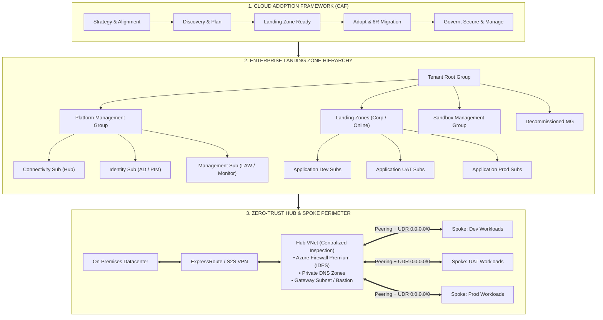
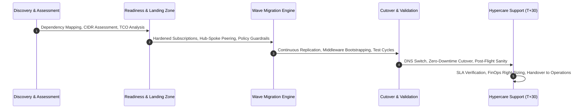
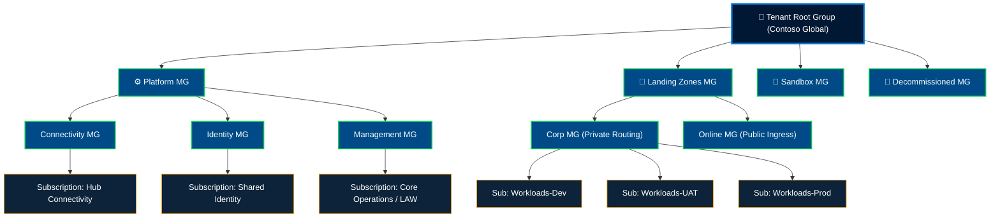
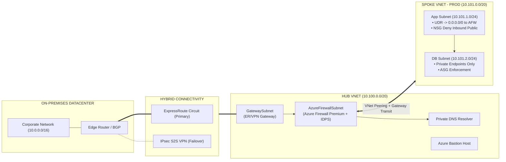
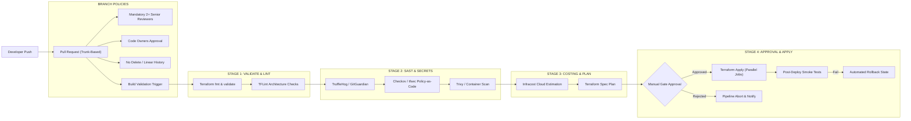
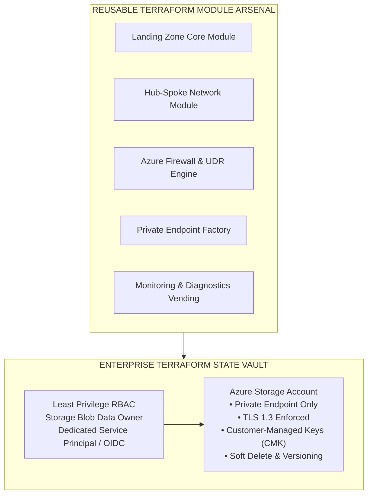
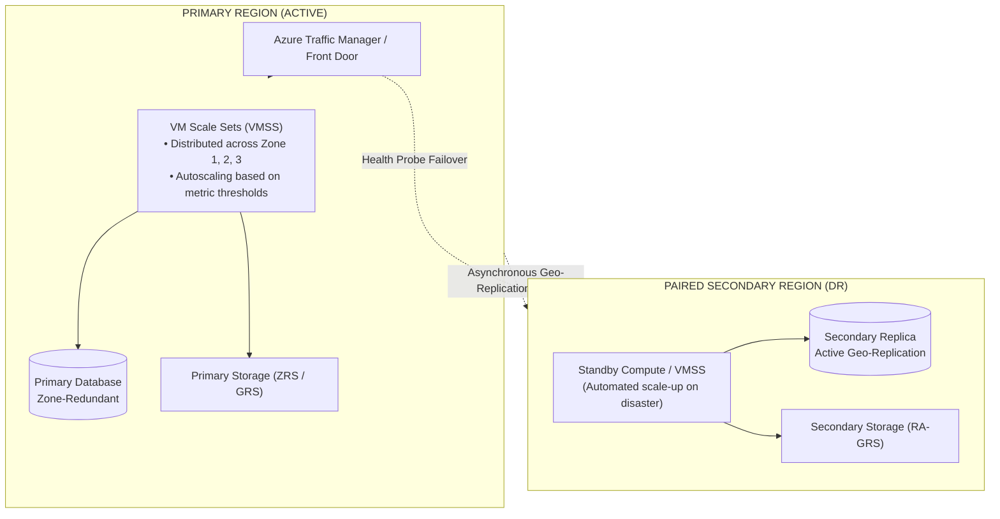
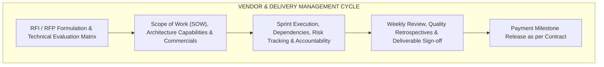
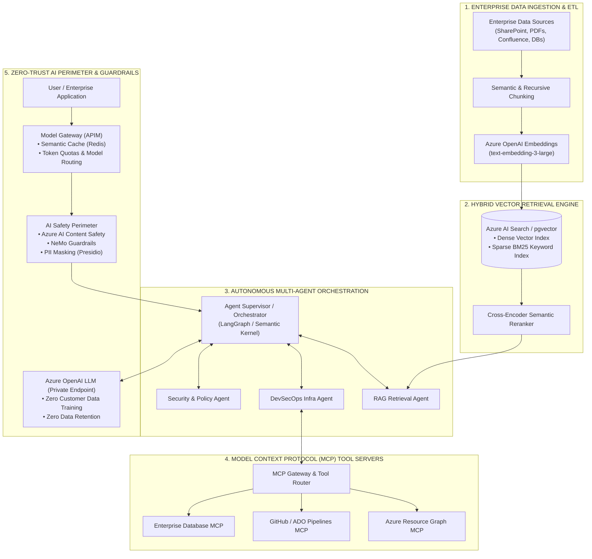

<div align="center">

<!-- BIG BOLD PROMINENT HEADER -->
# ⚡ ANUJ SRIVASTAVA ⚡
### 🛡️ Principal DevSecOps Architect • Enterprise Cloud & GenAIOps Systems Engineer 🚀
**5+ Years Battlefield Enterprise Experience • 100+ Production Cloud Migrations • Zero-Trust & FinOps Specialist**

<!-- DYNAMIC TYPING TEXT -->
<p align="center">
  <a href="https://github.com/anujsri192">
    
  </a>
</p>

<!-- DYNAMIC WAVE HEADER -->


<!-- STATUS BADGES -->
<p align="center">
  <a href="https://linkedin.com/in/anujsri192"></a>
  <a href="mailto:anujsri192@example.com"></a>
  <a href="#-technical-arsenal--tooling-matrix"></a>
  <a href="#-enterprise-architectural-pillars"></a>
  <a href="#-enterprise-genaiops-production-rag--autonomous-multi-agent-systems-mcp"></a>
  <a href="#-defense-in-depth-devsecops-pipeline-architecture"></a>
</p>

<!-- PUNCHY ELEVATOR PITCH -->
<p align="center">
  <strong>Transforming Enterprise IT with Zero-Trust Cloud Foundations • Enterprise Landing Zones • GenAIOps & Multi-Agent RAG • Battle-Tested CI/CD • Strategic FinOps</strong>
  <br />
  <em>Architecting production-scale cloud migrations, autonomous AI agentic workflows (MCP), hybrid networking, hardened DevSecOps pipelines, and resilient multi-region infrastructure.</em>
</p>

---

</div>

## 👨‍💼 About Anuj Srivastava

> *"True engineering mastery is measured by invisible excellence — where 100+ production workloads migrate seamlessly, zero-trust perimeter defenses repel threats autonomously, and infrastructure costs drop by 35%+ without impacting performance."*
> <br/>— **Anuj Srivastava**

I am **Anuj Srivastava**, a **Lead DevSecOps Architect & Enterprise Cloud / GenAIOps Systems Engineer** with **5 years of hands-on production experience** designing, securing, and operating mission-critical enterprise systems. 

My engineering battlefield encompasses the complete spectrum of enterprise infrastructure modernization:
* 🏢 **Hyperscale Cloud Migrations**: Directed and executed the migration of **100+ distributed applications** across Dev, UAT, and Production from On-Premises Datacenters to Azure with zero unplanned downtime.
* 🛡️ **Zero-Trust Enterprise Governance**: Architected scalable Tenant & Management Group hierarchies under the Microsoft Cloud Adoption Framework (CAF), enforcing automated **Azure Policy & Initiatives** (NIST SP 800-53, CIS Benchmark, ISO 27001) with strict **Microsoft Entra ID (PIM, RBAC, Conditional Access)**.
* ⚙️ **DevSecOps & IaC Automation**: 100% Terraform/OpenTofu automated Landing Zones, hardened remote state vaults (CMK, TLS 1.3, Soft Delete), pre-commit security gates (TruffleHog, Checkov, Trivy), and automated pipeline drift detection.
* 🤖 **Next-Gen AI Systems (GenAIOps / RAG / MCP)**: Architected private enterprise RAG pipelines (Azure AI Search, pgvector, hybrid semantic search) and Autonomous Multi-Agent workflows using the **Model Context Protocol (MCP)**, protected by **OWASP Top 10 for LLMs** guardrails.
* 💰 **FinOps Mastery**: Eradicated cloud waste through proactive compute right-sizing, idle disk pruning, DCR log ingestion optimization, and strategic Reserved Instance (RI) rate arbitrage.

```
┌────────────────────────────────────────────────────────────────────────────────────────┐
│                        ANUJ SRIVASTAVA — PRODUCTION IMPACT METRICS                     │
├──────────────────────────┬──────────────────────────┬──────────────────────────────────┤
│  🚀 100+ Workloads       │  🛡️ 100% Zero-Trust      │  ⚡ 100% IaC Automation          │
│  Dev, UAT, Prod Migrated │  Entra ID, PIM, Policies │  Zero Drift Terraform Pipelines  │
├──────────────────────────┼──────────────────────────┼──────────────────────────────────┤
│  🤖 Enterprise GenAIOps  │  💰 35%+ FinOps Savings  │  🔄 99.99% Resiliency            │
│  Hybrid RAG & MCP Agents │  Idle Pruning & AI Caching│  Multi-Region BCDR & AZ VMSS    │
├──────────────────────────┴──────────────────────────┴──────────────────────────────────┤
│  👥 Cross-Functional Technical Leadership • Vendor SOW Governance • Mentorship & RACI   │
└────────────────────────────────────────────────────────────────────────────────────────┘
```

---

## 🏛️ Enterprise Architectural Pillars



---

### 1️⃣ Cloud Adoption Framework (CAF) & 100+ App Migration Engine

Led and architected by **Anuj Srivastava**, directing enterprise migration programs transitioning **100+ legacy, monolithic, and distributed applications** from On-Premises Datacenters to Azure across Dev, UAT, and Production environments without business disruption.

* **CAF Lifecycle Implementation**: End-to-end alignment across **Strategy, Plan, Ready, Adopt, Govern, Secure, and Manage**.
* **6R Migration Rationalization**: Rehost (Lift & Shift via Azure Migrate), Replatform (PaaS modernization), Refactor (Containerization), Repurchase (SaaS), Retain, and Retire.
* **Non-Functional Enterprise Pillars**:
  * **Scalable & Robust**: Automated elasticity via VM Scale Sets (VMSS) and autoscaling tiers.
  * **Portable & Governed**: Containerized workloads with strict naming conventions, tagging taxonomies, and policy enforcement.
  * **Highly Available & Backed Up**: Zone-redundant configurations with automated geo-replication (GRS/RA-GRS).
  * **Cost-Optimized & Monitored**: Rigorous FinOps controls and real-time telemetry from day one.



<details>
<summary><strong>📋 Expand: Battle-Tested Migration Checklists (Pre, During & Post Cutover)</strong></summary>

#### A. Pre-Migration Checklist
- [x] **Discovery & Dependency Mapping**: Azure Migrate appliance deployment, network port mapping, application dependency graph generation.
- [x] **CIDR & IPAM Assessment**: Verification of non-overlapping IP space between on-premises and cloud VNets.
- [x] **Tenant & Subscription Readiness**: Target subscriptions onboarded with RBAC, budget thresholds, and baseline policies.
- [x] **Security Baseline Clearance**: Vulnerability assessments completed, secrets moved to Azure Key Vault with Private Endpoints.
- [x] **Cutover Runbook & RACI**: Hour-by-hour cutover timeline created with defined rollback gates and stakeholder sign-off.

#### B. During-Cutover Checklist (T-Zero Weekend)
- [x] Freeze source database transactions and initiate final delta delta-sync.
- [x] Validate target database data integrity, record count, and sequence parity.
- [x] Execute custom-data automated middleware bootstrap scripts (runtime, dependencies, certificates).
- [x] Update internal DNS pointers (Private DNS Zones) and flip traffic routes via Application Gateway / Azure Firewall.
- [x] Run automated smoke tests, end-to-end transaction tests, and security penetration sanity checks.

#### C. Post-Cutover & Hypercare Checklist (T+1 to T+30 Days)
- [x] **24x7 War Room Monitoring**: SRE latency tracking, log aggregation in Log Analytics, anomaly detection.
- [x] **Decommissioning Source Workloads**: Controlled shutdown of on-premises VMs and resource reclamation.
- [x] **FinOps Right-Sizing Review**: Convert on-demand SKUs to 1-Year or 3-Year Reserved Instances (RI) post steady-state analysis.
- [x] **Formal RACI Sign-off**: Deliverable handover to BAU operations and post-mortem retrospective documentation.

</details>

---

### 2️⃣ Enterprise Landing Zone & Microsoft Entra ID Hierarchy

Engineered hyperscale, multi-subscription Azure environments conforming to the Microsoft Cloud Adoption Framework Enterprise-Scale architecture.



* **Management Group Hierarchy & Boundary Design**:
  * Strict separation between **Platform Management Groups** (Management, Connectivity, Identity) and **Application Landing Zones** (Corp, Online).
  * Isolated **Sandbox** (with spend caps) and **Decommissioned** Management Groups (locked policies).
* **Policy-Driven Governance & Azure Initiatives**:
  * Continuous audit and automated enforcement of **NIST SP 800-53**, **CIS Microsoft Azure Foundations Benchmark**, and **ISO 27001**.
  * Automated **Subscription Vending Machine** for seamless subscription onboarding and offboarding.
  * Formal **Policy Exemption Framework**: Rigorous review, risk justification, compensating controls, and automated expiration tracking.
* **Microsoft Entra ID & Zero-Trust Identity**:
  * **Privileged Identity Management (PIM)**: Enforced Just-In-Time (JIT) access, MFA enforcement, and mandatory approval workflows.
  * Role-Based Access Control (**RBAC**): Least-privilege role assignment via security groups; eliminated individual direct user assignments.
  * **Conditional Access Policies**: Geo-fencing, device health verification, and continuous session token evaluation.

---

### 3️⃣ Zero-Trust Hub & Spoke Networking & Perimeter Defense

Designed robust, high-performance hybrid networking topologies connecting On-Premises Datacenters to cloud spokes with zero direct internet exposure.



* **IPAM & CIDR Strategy**: In-depth on-premises CIDR assessment to guarantee non-overlapping subnet allocations across multi-region environments.
* **Centralized Traffic Inspection & Controlled Egress**:
  * **Azure Firewall Premium**: TLS inspection, Intrusion Detection & Prevention System (IDPS), URL/FQDN filtering.
  * **User-Defined Routes (UDR)**: Forced tunneling `0.0.0.0/0` to Azure Firewall private IP; prevented unauthorized direct public internet breakouts.
* **Private PaaS Perimeter**:
  * Complete elimination of public IP addresses on Databases, Storage Accounts, and Key Vaults via **Azure Private Endpoints**.
  * Centralized **Azure Private DNS Zones** linked to Hub and Spokes for unified, split-horizon DNS resolution.
* **Hybrid Redundancy**: Dual-link topology utilizing **Azure ExpressRoute** with automated failover to route-based **Site-to-Site VPN**.

---

### 4️⃣ Defense-in-Depth DevSecOps Pipeline Architecture

Architected enterprise-grade CI/CD pipelines incorporating automated security gates, policy-as-code, and zero-drift infrastructure deployments.



#### Pipeline Engineering Standards
* **Trunk-Based Branching Model**: Short-lived feature branches, mandatory branch protection, linear Git history, and strict code owner sign-offs.
* **Modular YAML Templates**: Standardized pipeline components for Validate, Security Scan, Cost Estimate, Plan, Deploy, and Rollback.
* **Automated Drift Detection**: Nightly scheduled pipelines running `terraform plan -detailed-exitcode` to alert on out-of-band portal modifications.
* **Automated Middleware Bootstrapping**: Dynamic cloud-init and Custom Script Extensions for hands-off provisioning of IIS, Nginx, Apache, Tomcat, Java runtimes, and telemetry agents.

---

### 5️⃣ Terraform Landing Zone Engineering & State Hardening



* **Hardened Remote State Backend**:
  * Geo-redundant storage with Customer-Managed Keys (CMK) via Azure Key Vault.
  * Private Endpoint connectivity only; public network access fully disabled.
  * Immutable blob versioning, legal hold, and soft delete to prevent catastrophic state loss.
* **Quality & Security Guardrails**:
  * Integrated **TFLint**, **tfsec**, and **Checkov** directly into pipeline pre-commit and PR workflows.
  * **Infracost** integration providing PR-level breakdown of cloud spend impact before merging.
  * OIDC-based federated credentials eliminating persistent service principal client secrets.

---

### 6️⃣ FinOps & Cloud Financial Engineering

Spearheaded rigorous cost optimization initiatives yielding **35%+ immediate cloud spend reductions** across multi-subscription environments.

| Optimization Vector | Engineering Mechanism | Business Impact |
| :--- | :--- | :--- |
| **Idle & Orphaned Assets** | Automated identification and pruning of unattached managed disks, idle NICs, and unused public IPs | Immediate monthly OPEX reduction |
| **Compute Right-Sizing** | Azure Monitor CPU/RAM profiling; downsized oversized D-series / E-series VMs to cost-effective B-series/v5 SKUs | 20-30% compute cost savings |
| **Log Ingestion Tuning** | Re-engineered Data Collection Rules (DCR), filtered noisy security events, transitioned cold logs to Basic/Archive tiers | 40% reduction in Log Analytics spend |
| **Automated Start/Stop** | Azure Automation runbooks with schedule tags powering off non-production VMs during off-hours | 65% savings on Dev/UAT compute |
| **Rate Optimization** | Strategic portfolio modeling for 1-Year and 3-Year Azure Reserved Instances (RIs) and Savings Plans | Maximum discount on steady-state baselines |
| **Azure Hybrid Benefit** | Tag-governed compliance checks applying existing Windows Server and SQL Server on-premises licenses | Substantial license cost avoidance |
| **Backup Tiering** | Reconfigured backup policies: 7-day Operational Tier + Archive Vault tiering for long-term compliance retention | 50% backup storage cost reduction |

---

### 7️⃣ BCDR, High Availability & Resiliency Architecture

Engineered resilient cloud infrastructure capable of surviving regional outages while adhering to stringent RTO and RPO requirements.



* **Resiliency & Storage Durability**:
  * Implemented **Locally Redundant (LRS)**, **Zone-Redundant (ZRS)**, **Geo-Redundant (GRS)**, and **Read-Access Geo-Redundant (RA-GRS)** storage strategies based on data classification.
* **Compute High Availability**:
  * **Virtual Machine Scale Sets (VMSS)** deployed across multiple Availability Zones with custom health probes and predictive autoscaling.
* **Disaster Recovery Metrics**:
  * Target SLAs achieved: **RPO < 15 minutes**, **RTO < 60 minutes** using Azure Site Recovery (ASR) orchestration and immutable backup vaults.
  * Semi-annual automated DR drill execution verifying cross-region failover and failback integrity.

---

### 8️⃣ Observability, SRE & Telemetry

Engineered proactive cloud monitoring and autonomous self-healing capabilities using the Azure Monitor ecosystem.

* **Unified Log Aggregation**: Multi-subscription log forwarding into centralized **Log Analytics Workspaces (LAW)**.
* **KQL (Kusto Query Language) Threat & Latency Dashboards**:
  * Real-time query dashboards tracking P95/P99 application latency, HTTP 5xx error spikes, and network throughput drops.
  * Security hunting queries tracking anomalous Entra ID logins, brute force attempts, and NSG flow drops.
* **Automated Action Groups**: Alert routing via Webhooks, Azure Logic Apps, and PagerDuty for autonomous incident remediation and engineer dispatch.

---

### 9️⃣ Technical Leadership, Vendor Governance & RACI Framework

Led high-performing engineering initiatives, governed multi-vendor deliverables, and instituted technical excellence across enterprise organizations.



<details>
<summary><strong>📋 Expand: Enterprise Vendor RACI Matrix & Team Upskilling Framework</strong></summary>

#### Enterprise RACI Governance Model
| Lifecycle Phase | Enterprise Tech Lead (Anuj Srivastava) | Vendor Delivery Lead | Enterprise Security / InfoSec | Cloud Operations / SRE |
| :--- | :---: | :---: | :---: | :---: |
| **Architecture Design & Landing Zone Spec** | **A / R** | C | C | I |
| **RFP/RFI Technical Evaluation** | **A / R** | I | C | I |
| **Pipeline & Terraform Code Reviews** | **A / R** | R | C | I |
| **Security & Compliance Audits** | A | R | **A / R** | I |
| **Migration Wave Cutover Execution** | **A** | R | C | R |
| **Hypercare & Operational Handover** | A | R | I | **A / R** |

*(Legend: **R** = Responsible, **A** = Accountable, **C** = Consulted, **I** = Informed)*

#### Anuj Srivastava's Engineering Leadership & Upskilling Initiatives
* **Technical Lead Across Infra & Application Streams**: Bridged the gap between core infrastructure teams and application developers to accelerate cloud migration readiness.
* **Senior-Level Interview Panels**: Conducted technical assessments, live architectural evaluations, and coding interviews for hiring senior Cloud and DevOps talent.
* **Knowledge Transfer (KT) & Upskilling Academies**: Designed comprehensive transition documentation, architecture runbooks, and led workshops on Terraform best practices, Zero-Trust security, and FinOps fundamentals.

</details>

---

### 🔟 Enterprise GenAIOps, Production RAG & Autonomous Multi-Agent Systems (MCP)

Architected and secured high-performance, enterprise-grade Generative AI platforms, marrying hardened DevSecOps foundations with **Retrieval-Augmented Generation (RAG)**, **Autonomous Multi-Agent Orchestration**, and the **Model Context Protocol (MCP)**.



#### Production AI Engineering Pillars

* **Enterprise Retrieval-Augmented Generation (RAG)**:
  * **Hybrid Search with Semantic Reranking**: Combines dense vector similarity search (`text-embedding-3-large`) with sparse lexical matching (BM25) and cross-encoder rerankers in **Azure AI Search** and **PostgreSQL pgvector**.
  * **Context Engineering & Chunking**: Recursive character splitting with semantic boundary detection, metadata enrichment (timestamps, security tags, document ACLs), and parent-document retrieval to eradicate hallucinations.
* **Autonomous Multi-Agent Orchestration & Model Context Protocol (MCP)**:
  * **Model Context Protocol (MCP)**: Standardized client-server protocol enabling autonomous agents to safely query enterprise databases, execute read-only cloud infrastructure diagnostics, and interface with GitHub/ADO without credential leakage.
  * **Agentic Workflows**: Multi-agent state machines in **LangGraph**, **Microsoft Semantic Kernel**, and **AutoGen** with deterministic transition graphs, ReAct reasoning loops, and **Human-in-the-Loop (HITL)** approval gates for mission-critical write operations.
* **Zero-Trust Private AI Landing Zone & Guardrails**:
  * **Private AI Perimeter**: Azure OpenAI Service isolated behind Azure Private Endpoints with zero internet ingress/egress. Customer data is strictly isolated with **zero data retention** and **no training on customer prompts**.
  * **Multi-Layer Defense**: Integrated **Azure AI Content Safety** and **NeMo Guardrails** for real-time prompt injection prevention, jailbreak mitigation, and automated PII masking via **Microsoft Presidio**.
  * Rigorous alignment with the **OWASP Top 10 for Large Language Model Applications**.
* **DevSecOps for AI (GenAIOps / LLMOps Evaluation)**:
  * **Automated CI/CD Quality Gates**: Automated evaluation pipelines in Azure DevOps using **RAGAS** (Faithfulness, Answer Relevance, Context Precision, Context Recall) and **DeepEval** gating model and prompt deployments.
  * **Automated Adversarial Red-Teaming**: Pre-merge security scans simulating prompt injection and data poisoning attacks on pull requests.
* **FinOps for Generative AI & Token Optimization**:
  * **Semantic Caching**: Implemented in-memory Redis caching for vector queries, serving 30%+ of recurrent user queries with sub-10ms latency and $0 token spend.
  * **Intelligent Model Cascading**: API Gateway routing 70%+ of transactional tasks to lightweight models (GPT-4o-mini / Claude 3.5 Haiku) while dynamically reserving reasoning models (o1 / GPT-4o) for complex multi-step tasks, slashing enterprise LLM costs by 45%+.

<details>
<summary><strong>🤖 Expand: Enterprise GenAIOps, MCP Server & RAG Pipeline Production Spec</strong></summary>

#### A. Model Context Protocol (MCP) Server Architecture Spec
* **Standardized JSON-RPC Protocol**: Microservices exposing structured tools (`tools/list`, `tools/call`) and resources (`resources/read`) to agentic runners over secure transport (stdio / SSE with TLS 1.3).
* **Least Privilege Tool Scopes**: Agents execute through scoped service principals with strictly read-only entitlements (e.g. `Microsoft.Resources/subscriptions/read`, `Git.PullRequest.View`).
* **Tool Call Audit Logging**: Every agent tool execution is logged with timestamp, user context, input parameters, and execution outcome to centralized Log Analytics Workspaces.

#### B. RAG Quality & Faithfulness Benchmarking in CI/CD
| Metric | Target SLA | Evaluation Tool | CI/CD Action on Failure |
| :--- | :---: | :---: | :--- |
| **Faithfulness (Groundedness)** | `> 0.92` | RAGAS / Azure AI Studio | Pipeline Blocked; Flagged for hallucination review |
| **Answer Relevancy** | `> 0.88` | RAGAS | Warning generated; Prompt template tuning required |
| **Context Recall & Precision** | `> 0.90` | DeepEval | Index re-chunking and reranker threshold adjustment |
| **Adversarial Jailbreak Resistance** | `100%` | PyRIT / Custom Red-Team | Build Terminated; Security review triggered |

#### C. OWASP LLM Top 10 Enterprise Mitigation Matrix
* **LLM01 (Prompt Injection)**: Dual-layer defense with NeMo Guardrails input classification and Azure AI Content Safety prompt shield.
* **LLM02 (Sensitive Information Disclosure)**: Microsoft Presidio regex & NLP entity detection redacting SSNs, API keys, and PII before embedding and LLM inference.
* **LLM06 (Excessive Agency)**: Model Context Protocol (MCP) enforces human approval gates on any tool capable of modifying production state or triggering external communications.

</details>

---

## 🛠️ Technical Arsenal & Tooling Matrix

<div align="center">

### Cloud & Platforms


### GenAI, LLMOps & Autonomous Agent Frameworks

-0A84FF?style=for-the-badge&logo=anthropic&logoColor=white)


### Vector Databases, Embeddings & Semantic Search


### AI Security, Guardrails & Evaluation


### Infrastructure as Code & Automation


### DevSecOps, CI/CD & Pipeline Governance


### Security, Identity & Compliance


### Containers & Orchestration


### Networking & Perimeter Defense


### Observability, Telemetry & SRE


### Scripting & Data Engineering


</div>

---

## 📊 GitHub Telemetry & Activity Stats

<div align="center">

<table border="0">
  <tr>
    <td width="50%">
      
    </td>
    <td width="50%">
      
    </td>
  </tr>
  <tr>
    <td colspan="2" align="center">
      
    </td>
  </tr>
</table>

</div>

---

## 🤝 Let's Connect & Collaborate

Whether you are looking to architect **hyperscale cloud landing zones**, transition **100+ workloads with zero disruption**, deploy **production GenAIOps & Autonomous Multi-Agent RAG systems (MCP)**, or optimize **enterprise cloud economics (FinOps)**:

<div align="center">

<p align="center">
  <a href="https://linkedin.com/in/anujsri192"></a>
  <a href="mailto:anujsri192@example.com"></a>
  <a href="https://github.com/anujsri192"></a>
</p>

```
"Quality is not an act, it is a habit — in code, in architecture, and in leadership."
— Anuj Srivastava
```


</div>
